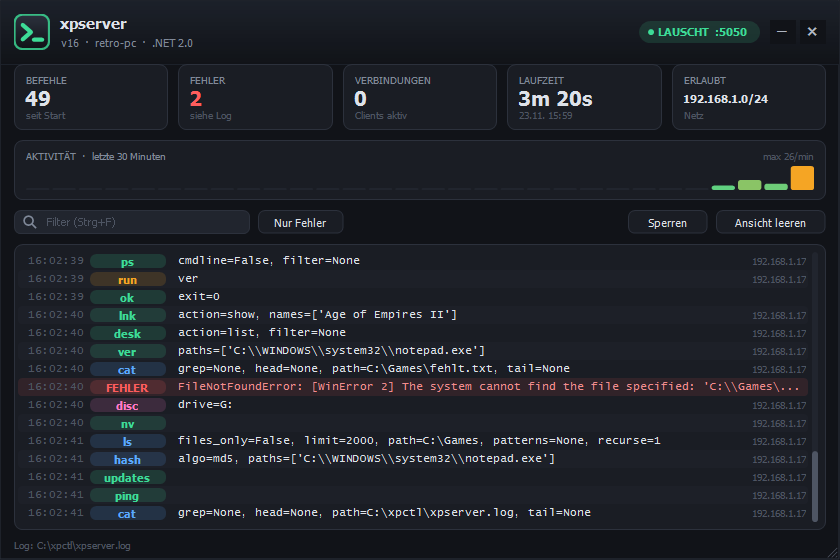

#  xpctl

Fernsteuerung für Windows-XP-Rechner aus dem Terminal. Gedacht für Retro-PCs: Programme und Installer starten, Dateien übertragen, Fenster lesen und bedienen, Registry und Einstellungen auslesen, Desktop-Verknüpfungen ordnen, CD-Images einhängen, CDs sichern, Treiber installieren, Spiele-Versionen bestimmen.

Zwei Teile:

| Teil | Läuft auf | Was |
|---|---|---|
| [`server/`](server/) | Windows XP | `xpserver.exe`: Symbol im Infobereich mit Live-Fenster, .NET 3.5, eine Datei ohne Installation |
| [`client/`](client/) | macOS, Linux, Windows | `xpctl.py`: ein Python-Skript ohne Abhängigkeiten (Python 3.9+) |

## In fünf Minuten

**Auf dem XP-Rechner**

1. `xpserver.exe` bauen: `cd server && ./build.sh` (braucht nur das [dotnet SDK](https://dotnet.microsoft.com/download), läuft auf macOS, Linux und Windows). Ergebnis: `server/dist/xpserver.exe`.
   Auf dem XP-Rechner muss .NET Framework 3.5 installiert sein (Windows XP bringt es nicht mit, Installer `dotnetfx35.exe` von Microsoft).
2. In einen Ordner legen, zum Beispiel `C:\xpctl\`, und doppelklicken.
3. Im Einrichtungsdialog ein Passwort vergeben und "Einrichten und starten" klicken. Netz, Autostart und Firewall sind vorausgefüllt.

**Auf dem eigenen Rechner**

    git clone https://github.com/maluramichael/xpctl && cd xpctl/client
    export XPCTL_HOST=192.168.1.50              # Adresse des XP-Rechners
    mkdir -p ~/.config/xpctl && printf '%s' 'PASSWORT' > ~/.config/xpctl/key && chmod 600 ~/.config/xpctl/key
    ./xpctl.py ping
    ./xpctl.py run ver
    ./xpctl.py sysinfo

Alle Befehle: [`client/README.md`](client/README.md). Server, Symbol, Konfiguration, Update: [`server/README.md`](server/README.md).

Wer noch den alten Python-Server (`xpserver.py` + `xpserver.bat`) nutzt: `./xpctl.py migrate` stellt den XP-Rechner in einem Schritt auf `xpserver.exe` um.

## Sicherheit

Der Server führt auf Anforderung beliebige Befehle aus. Wer das Passwort kennt und im erlaubten Netz sitzt, hat volle Kontrolle über den XP-Rechner. Der Verkehr ist nicht verschlüsselt (die Anmeldung schon, per HMAC-SHA256). Nur im eigenen LAN betreiben, nie ins Internet freigeben.

## Ordner

| Pfad | Inhalt |
|---|---|
| `client/` | `xpctl.py`, Versions- und Kopierschutz-Datenbank, Beispiel für Desktop-Gruppen |
| `server/` | Quellcode von `xpserver.exe` (C#), `build.sh`, Beispielkonfiguration, Tests, alter Python-Server unter `legacy-python/` |
| `docs/` | Protokoll |
| `tools/` | `wpchanger.pyw`: kleiner Wallpaper-Wechsler für den XP-Rechner (`pythonw wpchanger.pyw ORDNER`, alle 30 Minuten ein zufälliges BMP) |

## Lizenz

MIT, siehe `LICENSE`.
