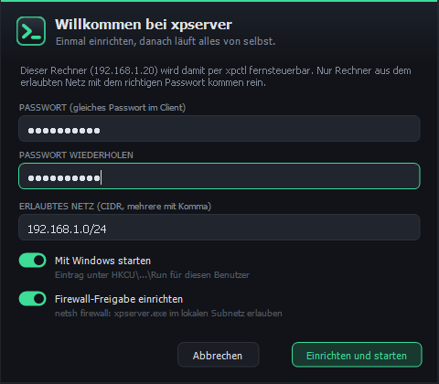
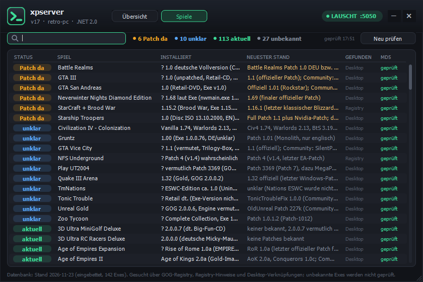
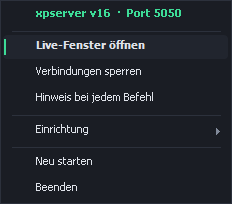

# xpserver (server for Windows XP)

`xpserver.exe` runs on the XP machine as a tray icon and takes commands from `xpctl.py`. A single exe with no installation, built for .NET Framework 3.5. Windows XP does not ship with it: install `dotnetfx35.exe` from Microsoft once if it is missing (it shows up under Add or Remove Programs as "Microsoft .NET Framework 3.5").

The UI is in German for now. Button and menu labels below are quoted as they appear, with a translation.

## Setup on the XP machine

1. Copy `xpserver.exe` into a folder, for example `C:\xpctl\`.
2. Double-click it.
3. The setup dialog asks for a password and the allowed network (prefilled with the machine's network). Autostart and the firewall rule are already ticked. Click "Einrichten und starten" (set up and start).



Done. The server starts by itself at the next login. If you prefer to set it up by hand: put `xpserver.json` and `xpctl.key` next to the exe, then no dialog appears.

Moving from the old Python server: run `./xpctl.py migrate` on the client (see `client/README.md`).

## The tray icon

| Color | Meaning |
|---|---|
| green | ready |
| yellow, with ring | working on a command |
| red | the last command failed (for 8 seconds) |
| grey | connections locked |

Left-click opens the live window: status, number of commands and errors, open connections, uptime, activity over the last 30 minutes and the log with a filter (Ctrl+F) and "Nur Fehler" (errors only). Esc or × puts it back into the tray.

The "Spiele" (games) tab lists the games the built-in version database knows, with installed and latest version: "Patch da" (patch available) first, then "unklar" (unclear), "aktuell" (up to date) and "unbekannt" (unknown: desktop shortcut without a database entry). The list is there within a fraction of a second, the md5 check then runs in the background at lowest priority and pauses while a program runs fullscreen. Hovering a row shows exe, version, latest version and md5. "Neu prüfen" (check again) searches again. How the search works is described in `client/README.md` under "Game versions" (`xpctl gamecheck` shows the same list).




Right-click shows the menu:



- **Verbindungen sperren** (lock connections): new connections are refused, running commands finish. Handy when someone is sitting at the machine.
- **Hinweis bei jedem Befehl** (notify on every command): a balloon tip per command (off by default).
- **Einrichtung** (setup): autostart on/off, firewall rule, configuration, log file, open folder.
- **Neu starten** (restart), **Beenden** (quit).

The server never steals focus and shows no balloon tips while a program runs fullscreen (games).

## Configuration

`xpserver.json` next to `xpserver.exe` (other location: `--config` or `XPCTL_CONFIG`). Template: `xpserver.example.json`. Features that need an entry report `nicht konfiguriert: ...` (not configured) without it.

| Key | Meaning | Without entry |
|---|---|---|
| `allow` | allowed networks (CIDR). Alternatively `--allow` or `XPCTL_ALLOW` (comma-separated) | setup dialog on start |
| `rm_roots` | folders where `rm` may delete without `--force` (the desktops are always allowed) | `rm` only with `--force` |
| `games_dir` | folder with the games, one subfolder per game (for `games`) | the exe's folder counts as the game folder |
| `cd_drive` | CD/DVD drive, for example `E:` | first CD drive |
| `image_drive` | virtual Alcohol drive, for example `G:` | `mount`/`unmount` report "not configured" |
| `alcohol_axcmd` | path to `AxCmd.exe` from Alcohol 120% | `mount`/`unmount` report "not configured" |
| `launcher_script` | your own VBS that mounts an image and starts an exe (arguments: image, folder, exe) | `lnk launcher` reports "not configured" |
| `launcher_backup_dir` | folder where `lnk launcher` backs up an existing shortcut | no backup |

Password, in this order: `--key-file FILE`, environment variable `XPCTL_KEY`, `xpctl.key` next to the exe, otherwise a dialog asks (with "Merken", remember).

More start options: `--port N` (default 5050), `--bind ADDRESS` (default 0.0.0.0), `--no-watchdog`, `--demo` (shows neutral values instead of machine name, IPs and path, for screenshots; the images here were made that way).

## Files next to the exe

| File | Contents |
|---|---|
| `xpserver.json` | configuration |
| `xpctl.key` | password (plain text, only for this machine) |
| `xpserver.log` | log of all commands (UTF-8, grows; can be deleted at any time) |
| `xpserver-md5.tsv` | md5 cache for the game check (can be deleted, gets rebuilt) |
| `xpserver.exe.bak` | only briefly during an update |

## Update, crash, restart

- **Update** (`xpctl.py update` from the client): the server checks the checksum and that the file is an `xpserver.exe`, renames the running exe to `.bak`, puts the new one in place and starts it. Only once the new one is listening does the old one exit. If the new one does not come up within 30 seconds, it is stopped, the old exe is put back and the old version keeps listening.
- **Crash**: a second, invisible `xpserver.exe` process runs next to the server as a watchdog. If the server exits unexpectedly, the watchdog restarts it (at most three times in a row, then it gives up, see the log).
- Sockets are not inherited by child processes, so a program started with `run --detach` does not hold on to the port.

## Security

- Traffic is **not encrypted**. Only run it in a trusted LAN, never on the internet.
- On request the server runs **arbitrary commands** and reads and writes files. Anyone who knows the password and sits in an allowed network has full control over the machine.
- Login via HMAC-SHA256 with a challenge in both directions, the password never goes over the wire.
- Without an allowed network the server does not start.

## Building it yourself

Needs only the [dotnet SDK](https://dotnet.microsoft.com/download) (6 or newer). Builds on macOS, Linux and Windows, the reference assemblies for .NET 3.5 come from NuGet.

    cd server
    ./build.sh            # -> server/dist/xpserver.exe (+ LIESMICH.txt, xpserver.example.json)

Without the script: `dotnet build -c Release`, result in `bin/Release/net35/xpserver.exe`.

## Layout

| Folder | Contents |
|---|---|
| `Core/` | startup and options (`Program.cs`), protocol, login and dispatch (`Net.cs`), JSON (`Json.cs`), registry access modeled on Python's `winreg` (`Reg.cs`), child processes without a console window (`Proc.cs`), configuration, log, watchdog and update (`Supervisor.cs`) |
| `Ops/` | the commands, one file per group: `Core.cs` (ping, run, put, get, update), `Ui.cs`, `Inventory.cs`, `Shell.cs`, `Drives.cs`, `Files.cs` |
| `Ui/` | tray icon, menu, live window, dialogs, first-run setup |
| `tests/` | `parity.py` and test cases |
| `legacy-python/` | the old Python server (reference for the port, no longer developed) |

A new command is a static method with an attribute, it is found via reflection at startup:

```csharp
[Op("hello")]
static J Hello(Conn c, Req r)
{
    return J.Ok("text", "Hello " + r.Str("name", "World"));
}
```

Rules for .NET 3.5 and for the response format are in [`PORTING.md`](PORTING.md).

### Temperature sources

`temps` queries all sources from `Ops/Temps.cs`. Built in:

| Source | Delivers | Needs |
|---|---|---|
| `acpi` | mainboard thermal zone with throttle and shutdown limits | ACPI BIOS with a thermal zone |
| `smart` | temperature of every hard disk and SSD (SMART 194/190) | IDE/SATA drives, admin rights |
| `nvidia` | GPU temperature | NVIDIA driver with `nvapi.dll` (from about 2007) |
| `hwinfo` | every temperature HWiNFO knows (CPU cores, chipset, GPU, drives) with names | HWiNFO running with "Shared Memory Support" |
| `speedfan` | temperatures from SpeedFan, numbered only | SpeedFan running |

If a source is missing, the reason is listed under `sources` in the response and the others still deliver. A new source is a class:

```csharp
public class MySource : TempSource
{
    public override string Name { get { return "mine"; } }
    public override void Read(List<J> into)
    {
        // not available: throw new Unavailable("reason");
        into.Add(Temps.Sensor(Name, "Sensor name", "cpu", 42.0));
    }
}
```

plus an entry in `Temps.Sources`. In the client, add it to the `TEMP_SOURCES` list (only used for the help text).

## Tests

`tests/parity.py` sends the same requests to two servers and compares the JSON responses field by field. That is how the port was checked against the old Python server (old server on 5050, new one on a test port):

    tests/parity.py --host 192.168.1.50 --a 5050 --b 5051 tests/cases/*.jsonl

The cases are JSON lines, `_ignore` hides fields that may change between two calls (free memory, time).

The protocol is described in [`../docs/protocol.md`](../docs/protocol.md).
