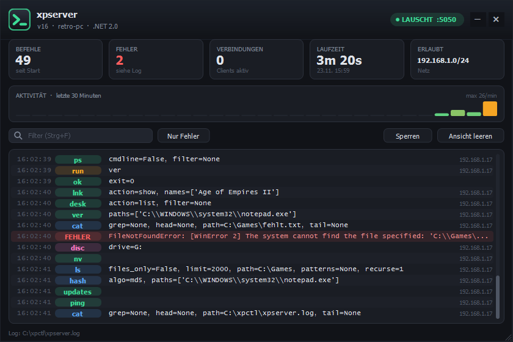

# xpserver (Server für Windows XP)

`xpserver.exe` läuft auf dem XP-Rechner als Symbol im Infobereich und nimmt Befehle von `xpctl.py` entgegen. Eine einzelne Exe ohne Installation, gebaut für .NET Framework 3.5. Windows XP bringt das nicht mit: einmalig `dotnetfx35.exe` von Microsoft installieren, falls es noch fehlt (zu sehen unter Software als "Microsoft .NET Framework 3.5").

## Einrichten auf dem XP-Rechner

1. `xpserver.exe` in einen Ordner kopieren, zum Beispiel `C:\xpctl\`.
2. Doppelklicken.
3. Der Einrichtungsdialog fragt nach Passwort und erlaubtem Netz (vorausgefüllt mit dem Netz des Rechners). Autostart und Firewall-Freigabe sind schon angehakt. "Einrichten und starten" klicken.


Fertig. Beim nächsten Login startet der Server von selbst. Wer lieber von Hand einrichtet: `xpserver.json` und `xpctl.key` neben die Exe legen, dann erscheint kein Dialog.

Umstieg vom alten Python-Server: auf dem Client `./xpctl.py migrate` (siehe `client/README.md`).

## Das Symbol

| Farbe | Bedeutung |
|---|---|
| grün | bereit |
| gelb, mit Ring | arbeitet gerade einen Befehl ab |
| rot | der letzte Befehl ist fehlgeschlagen (8 Sekunden lang) |
| grau | Verbindungen gesperrt |

Linksklick öffnet das Live-Fenster: Status, Zahl der Befehle und Fehler, offene Verbindungen, Laufzeit, Aktivität der letzten 30 Minuten und das Protokoll mit Filter (Strg+F) und "Nur Fehler". Esc oder × legt es zurück in den Infobereich.



Rechtsklick zeigt das Menü:


- **Verbindungen sperren**: neue Verbindungen werden abgelehnt, laufende Befehle laufen zu Ende. Praktisch, wenn gerade jemand am Rechner sitzt.
- **Hinweis bei jedem Befehl**: Sprechblase pro Befehl (Standard aus).
- **Einrichtung**: Autostart an/aus, Firewall-Freigabe, Konfiguration, Log-Datei, Ordner öffnen.
- **Neu starten**, **Beenden**.

Der Server nimmt sich nie selbst den Fokus und zeigt keine Sprechblasen, solange ein Programm im Vollbild läuft (Spiele).

## Konfiguration

`xpserver.json` neben `xpserver.exe` (anderer Ort: `--config` oder `XPCTL_CONFIG`). Vorlage: `xpserver.example.json`. Funktionen, die einen Eintrag brauchen, melden ohne ihn `nicht konfiguriert: ...`.

| Schlüssel | Bedeutung | Ohne Eintrag |
|---|---|---|
| `allow` | erlaubte Netze (CIDR). Alternativ `--allow` oder `XPCTL_ALLOW` (kommagetrennt) | Einrichtungsdialog beim Start |
| `rm_roots` | Ordner, in denen `rm` ohne `--force` löschen darf (die Desktops sind immer erlaubt) | `rm` nur mit `--force` |
| `games_dir` | Ordner mit den Spielen, je Unterordner ein Spiel (für `games`) | Ordner der Exe gilt als Spielordner |
| `cd_drive` | CD/DVD-Laufwerk, z. B. `E:` | erstes CD-Laufwerk |
| `image_drive` | virtuelles Alcohol-Laufwerk, z. B. `G:` | `mount`/`unmount` melden "nicht konfiguriert" |
| `alcohol_axcmd` | Pfad zu `AxCmd.exe` von Alcohol 120% | `mount`/`unmount` melden "nicht konfiguriert" |
| `launcher_script` | eigenes VBS, das ein Image einhängt und eine Exe startet (Argumente: Image, Ordner, Exe) | `lnk launcher` meldet "nicht konfiguriert" |
| `launcher_backup_dir` | Ordner, in den `lnk launcher` eine vorhandene Verknüpfung sichert | keine Sicherung |

Passwort, in dieser Reihenfolge: `--key-file DATEI`, Umgebungsvariable `XPCTL_KEY`, `xpctl.key` neben der Exe, sonst fragt ein Dialog (mit "Merken").

Weitere Startoptionen: `--port N` (Standard 5050), `--bind ADRESSE` (Standard 0.0.0.0), `--no-watchdog`, `--demo` (zeigt neutrale Werte statt Rechnername, IPs und Pfad, für Screenshots; die Bilder hier sind so entstanden).

## Dateien neben der Exe

| Datei | Inhalt |
|---|---|
| `xpserver.json` | Konfiguration |
| `xpctl.key` | Passwort (Klartext, nur für diesen Rechner) |
| `xpserver.log` | Protokoll aller Befehle (UTF-8, wächst; darf jederzeit gelöscht werden) |
| `xpserver.exe.bak` | nur kurz während eines Updates |

## Update, Absturz, Neustart

- **Update** (`xpctl.py update` vom Client): Der Server prüft Prüfsumme und dass es eine `xpserver.exe` ist, benennt die laufende Exe in `.bak` um, legt die neue hin und startet sie. Erst wenn die neue lauscht, beendet sich die alte. Kommt die neue nicht innerhalb von 30 Sekunden hoch, wird sie beendet, die alte Exe zurückgelegt und die alte Version lauscht weiter.
- **Absturz**: Neben dem Server läuft ein zweiter, unsichtbarer `xpserver.exe`-Prozess als Wächter. Endet der Server unerwartet, startet der Wächter ihn neu (höchstens dreimal hintereinander, danach Schluss, siehe Log).
- Sockets werden nicht an Kindprozesse vererbt, ein per `run --detach` gestartetes Programm hält den Port also nicht fest.

## Sicherheit

- Der Verkehr ist **nicht verschlüsselt**. Nur im vertrauenswürdigen LAN betreiben, nie ins Internet.
- Der Server führt auf Anforderung **beliebige Befehle** aus und liest und schreibt Dateien. Wer das Passwort kennt und im erlaubten Netz sitzt, hat volle Kontrolle über den Rechner.
- Anmeldung per HMAC-SHA256 mit Challenge in beide Richtungen, das Passwort geht nicht über die Leitung.
- Ohne erlaubtes Netz startet der Server nicht.

## Selbst bauen

Braucht nur das [dotnet SDK](https://dotnet.microsoft.com/download) (6 oder neuer). Baut auf macOS, Linux und Windows, die Referenz-Assemblies für .NET 3.5 kommen per NuGet.

    cd server
    ./build.sh            # -> server/dist/xpserver.exe (+ LIESMICH.txt, xpserver.example.json)

Ohne Skript: `dotnet build -c Release`, Ergebnis in `bin/Release/net35/xpserver.exe`.

## Aufbau

| Ordner | Inhalt |
|---|---|
| `Core/` | Start und Optionen (`Program.cs`), Protokoll, Anmeldung und Verteilung (`Net.cs`), JSON (`Json.cs`), Registry wie Pythons `winreg` (`Reg.cs`), Kindprozesse ohne Konsolenfenster (`Proc.cs`), Konfiguration, Log, Wächter und Update (`Supervisor.cs`) |
| `Ops/` | die Befehle, eine Datei je Gruppe: `Core.cs` (ping, run, put, get, update), `Ui.cs`, `Inventory.cs`, `Shell.cs`, `Drives.cs`, `Files.cs` |
| `Ui/` | Symbol, Menü, Live-Fenster, Dialoge, Ersteinrichtung |
| `tests/` | `parity.py` und Testfälle |
| `legacy-python/` | der alte Python-Server (Referenz für den Port, wird nicht mehr weiterentwickelt) |

Ein neuer Befehl ist eine statische Methode mit Attribut, sie wird beim Start per Reflection gefunden:

```csharp
[Op("hallo")]
static J Hallo(Conn c, Req r)
{
    return J.Ok("text", "Hallo " + r.Str("name", "Welt"));
}
```

Regeln für .NET 3.5 und für das Antwortformat stehen in `PORTING.md`.

## Tests

`tests/parity.py` schickt dieselben Anfragen an zwei Server und vergleicht die JSON-Antworten feldgenau. So wurde der Port gegen den alten Python-Server geprüft (alter Server auf 5050, neuer auf einem Testport):

    tests/parity.py --host 192.168.1.50 --a 5050 --b 5051 tests/cases/*.jsonl

Die Fälle sind JSON-Zeilen, `_ignore` blendet Felder aus, die sich zwischen zwei Aufrufen ändern dürfen (freier Speicher, Zeit).

Das Protokoll ist in `../docs/protokoll.md` beschrieben.
